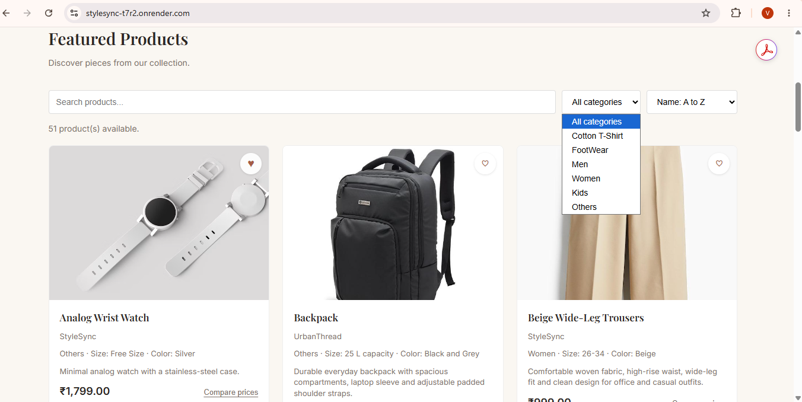
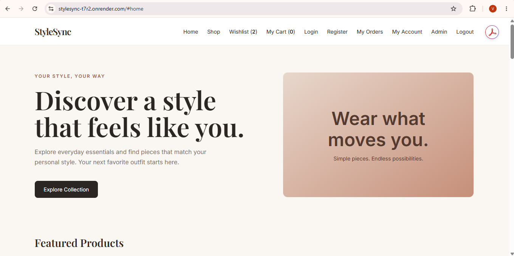
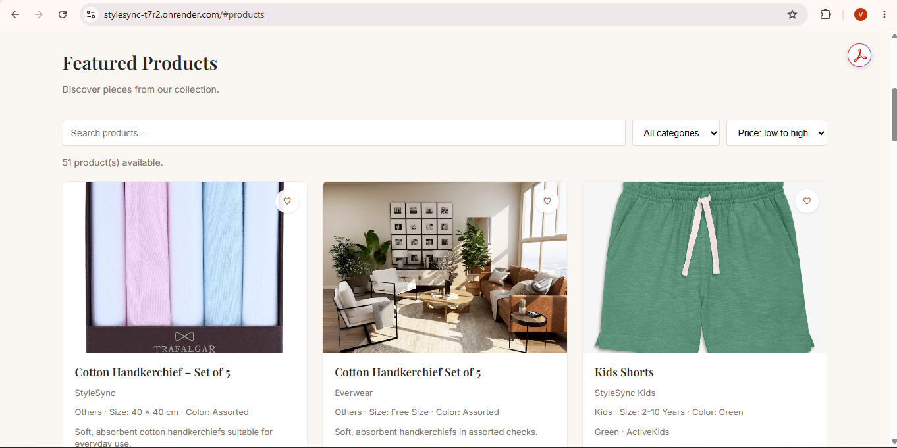
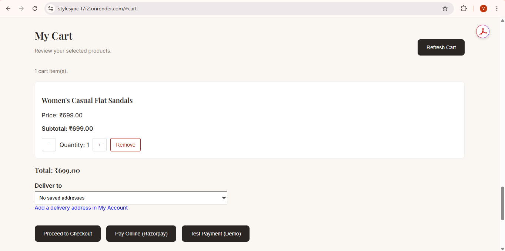
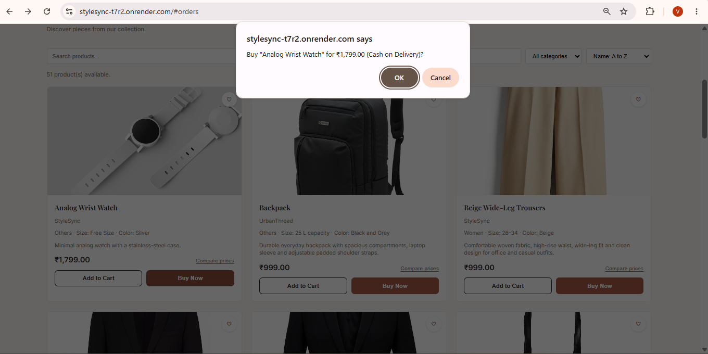
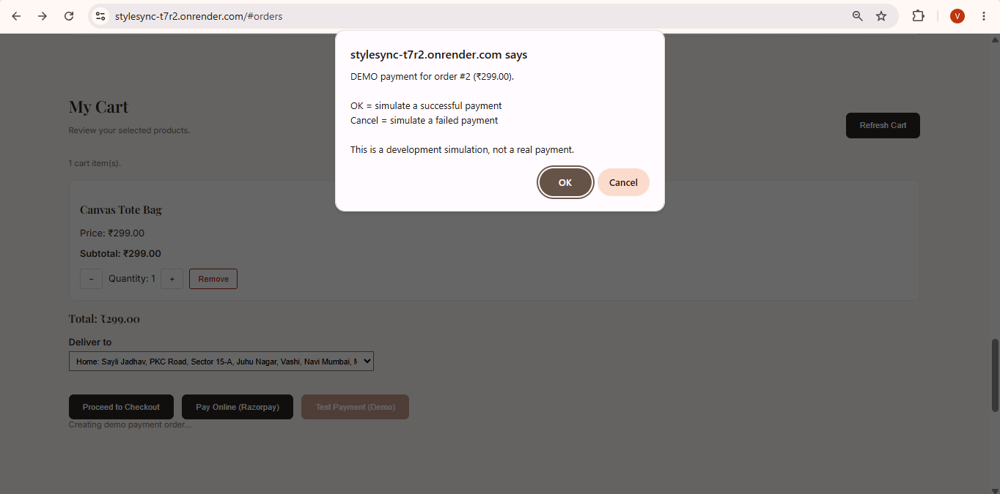
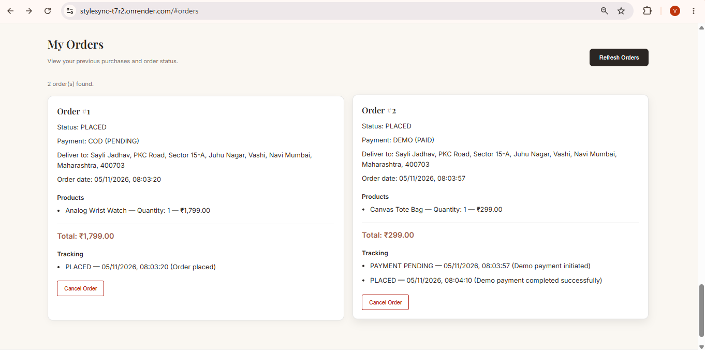
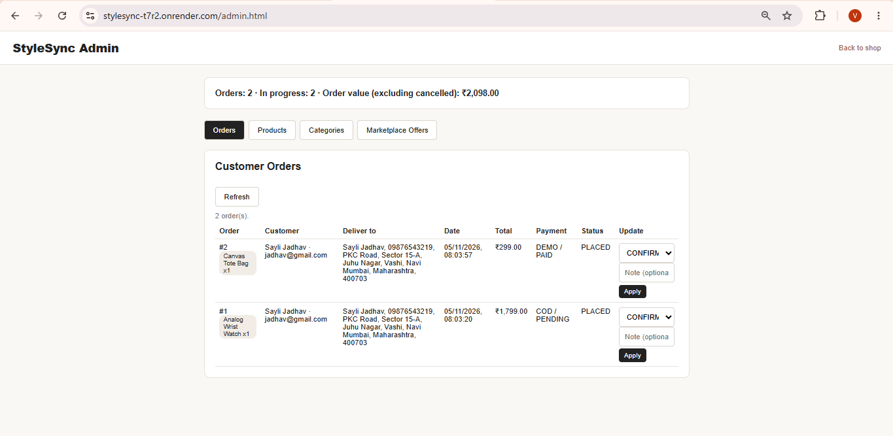

# StyleSync

A fashion e-commerce backend built with **Java 21, Spring Boot and PostgreSQL**, with a simple HTML/JavaScript storefront and admin panel.

> **Status:** work in progress. There is no AI feature yet. The project was renamed from *StyleSync-AI* to *StyleSync*, and AI-based style suggestions are a future plan.

## Features

- **Accounts and security:** registration, login with JWT, Spring Security, `USER` and `ADMIN` roles, forgot/reset password.
- **Catalogue:** products and categories, search, sorting, paging, and deactivating products instead of deleting them. Only admins can change the catalogue.
- **Cart and wishlist:** per-user cart and wishlist.
- **Checkout:** Cash on Delivery, Buy Now, Razorpay (test mode), and a demo/mock payment for local development.
- **Delivery address snapshot:** the customer picks a saved address at checkout. The address and customer details are copied onto the order, so editing or deleting the saved address later never changes an existing order.
- **Order management:** order history, cancellation, status history, and an admin screen to move orders through `PLACED → CONFIRMED → SHIPPED → OUT_FOR_DELIVERY → DELIVERED`.
- **Price comparison:** price offers per product from different platforms (demo data).
- **Money handling:** `BigDecimal` for all amounts, and the server always takes prices from the database, never from the client.

## Tech stack

Java 21, Spring Boot 4, Spring Data JPA / Hibernate, Spring Security, JWT (jjwt), PostgreSQL, Razorpay Java SDK, JUnit 5, Mockito, Maven.

## Run it locally

**You need:** JDK 21 and PostgreSQL.

1. Create the database:
   ```sql
   CREATE DATABASE stylesync_ai;
   ```
2. Set environment variables. This repo never stores secrets.

   | Variable | Purpose |
      |---|---|
   | `DB_PASSWORD` | PostgreSQL password for user `postgres` |
   | `JWT_SECRET` | Base64 secret used to sign JWTs |
   | `RAZORPAY_KEY_ID`, `RAZORPAY_KEY_SECRET` | Razorpay **test** keys (optional) |
   | `APP_DEMO_PAYMENT_ENABLED` | `true` to enable the demo payment button (local only) |

   PowerShell example:
   ```powershell
   $env:DB_PASSWORD = "your-db-password"
   $env:JWT_SECRET  = "your-base64-secret"
   ```
3. Start the app (the `dev` profile seeds demo products):
   ```powershell
   .\mvnw.cmd spring-boot:run "-Dspring-boot.run.profiles=dev"
   ```
4. Open `http://localhost:8080/register.html`, create an account, then log in.

### Making an admin

Registration always creates a `USER`. To create an admin, promote an account in the database:

```sql
UPDATE users SET role = 'ADMIN' WHERE email = 'you@example.com';
```

Log in again, then open `http://localhost:8080/admin.html`.

## Run the tests

The integration tests need PostgreSQL and a database named `stylesync_ai_test`.

```powershell
$env:DB_PASSWORD = "your-db-password"
.\mvnw.cmd test
```

## Main API endpoints

All endpoints except auth and public product reads need `Authorization: Bearer <token>`.

| Area | Endpoints |
|---|---|
| Auth | `POST /api/auth/register`, `POST /api/auth/login`, `POST /api/auth/forgot-password`, `POST /api/auth/reset-password` |
| Account | `GET/PUT /api/account/profile`, `PUT /api/account/password`, `GET/POST /api/account/addresses`, `PUT/DELETE /api/account/addresses/{id}` |
| Products | `GET /api/products`, `/active`, `/search`, `/page`, `/sort`, `/category/{id}`, `/{id}`; admin: `POST`, `PUT`, `DELETE`, `PATCH /{id}/reactivate` |
| Cart | `POST /api/cart`, `GET /api/cart/{cartId}`, `POST/PUT/DELETE /api/cart/{cartId}/items...` |
| Orders | `POST /api/orders/cod/{cartId}`, `POST /api/orders/buy-now`, `GET /api/orders`, `GET /api/orders/{id}`, `POST /api/orders/{id}/cancel` |
| Payments | `POST /api/payments/razorpay/orders/{cartId}`, `POST /api/payments/razorpay/verify`; dev only: `/api/payments/demo/...`, `/api/payments/mock/...` |
| Admin | `GET /api/admin/orders`, `PATCH /api/admin/orders/{id}/status` |

### Checkout request body

Cart checkout (COD, Razorpay, demo) takes the delivery address:

```json
{ "addressId": 7 }
```

Buy Now takes the product too:

```json
{ "productId": 5, "quantity": 2, "addressId": 7 }
```

A missing `addressId` returns **400**. An address that does not exist or belongs to another user returns **404**.

## Known limitations and next steps

- Password reset emails are not sent yet. The reset link is only written to the application log.
- More tests are needed for account/address management, admin order management and the password reset flow.
- AI-based style suggestions and cloud deployment are planned.

## Screenshots

### Landing Page


### Home / Product Listing


### Product Details


### Cart


### Checkout - Cash on Delivery


### Checkout - Demo Payment


### My Orders


### Admin - Order Status
